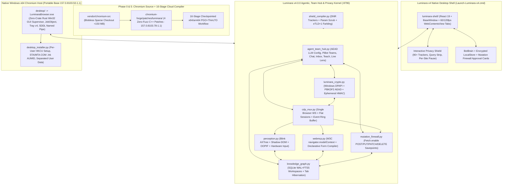

# Luminara Browser v4.0.0 — Spatial Shell, PiBot Team Hub, 100x Engine & REA Architecture (`docs/architecture-100x.md`)

Luminara Browser v4.0.0 unites a **Warm Atelier Precision × Calm Spatial OS** desktop browser shell (`luminara-shell/`), **PiBot Multi-Bot Teams & Team Hub** (`forge/agent_team_hub.py`), a **Native Rust Win32 GUI Supervisor** (`LuminaraBrowser.exe`), and **134 Ungoogled-Chromium + 4 Zero-Fuzz Luminara C++ patches** (patch track `157.0.8103.78-1.1` · portable binary base `157.0.8103.50-1.1`) into one clean-room human + AI co-browsing platform.

## Module Map (All Python Files `< 1,000` Lines · Zero Third-Party Python Dependencies · All TS/TSX `< 450` Lines)

| Module | Responsibility |
| :--- | :--- |
| `luminara-shell/` (`Launch-Luminara-v4.cmd`) | Luminara v4 Warm Atelier 3-Zone Spatial OS: isolated Chromium `WebContentsView` tabs, working private omnibox, interactive Privacy Shield, PiBot Multi-Bot Drawer, Approval Cards, encrypted `LocalStore`, and `npm run smoke` E2E gate |
| `chromium-forge/forge/agent_team_hub.py` | v4 Team Hub backend: AEAD-encrypted LLM provider config (`outputs/llm_config.json`), Ollama prober, PiBot-enriched teams (`Pi`, `Remy`, `Dana`, `Research Team`), fenced live tab chat, unified Approval Inbox, password-safe Teach Mode recorder, tab focus, and Cross-Tab Live Lens |
| `chromium-forge/forge/mcp_specs.py` | Canonical `v4.0.0` `APP_VERSION`, 28-Tool / 9-Resource MCP v2 schemas, `/llms.txt` & `/.well-known/agent.json` builders with v4 Team Hub & Desktop Lifecycle discovery |
| `chromium-forge/forge/chromium_src.py` | Blobless sparse checkout (`<150 MB`), upstream patch dry-run & version provenance audit (`157.0.8103.78-1.1`) |
| `chromium-forge/forge/luminara_crypto.py` | Windows DPAPI (`CryptProtectData`), pure-stdlib HKDF+CTR+HMAC AEAD, ephemeral session tokens, ledger signatures |
| `chromium-forge/forge/luminara_security.py` | AEAD-encrypted origin-pinned `LuminaraVault` (auto-migrates legacy plaintext) & binary-safe `LuminaraRedactor` |
| `chromium-forge/forge/cdp_mux.py` | Persistent browser-level multiplexed CDP WebSocket (`<1.5ms` RTT, zero `F12` lockouts, OOPIF flat sessions, event bus) |
| `chromium-forge/forge/perception.py` | Native Blink `AXTree` + open Shadow-DOM piercing + OOPIF indexing + compositor hardware mouse/keyboard input |
| `chromium-forge/forge/webmcp.py` | W3C WebMCP (`navigator.modelContext`) bootstrap + declarative `<form toolname>` / semantic form compiler |
| `chromium-forge/forge/mutation_firewall.py` | `Fetch.enable` savepoint interceptor pausing `POST`/`PUT`/`PATCH`/`DELETE` with secret-scrubbed diff preview |
| `chromium-forge/forge/knowledge_graph.py` | SQLite WAL + FTS5 cross-tab knowledge graph, named Workspaces, and `Page.setWebLifecycleState('frozen')` tab hibernation |
| `chromium-forge/forge/shield_compiler.py` | Interactive Privacy Shield v3 (DNR tracker + query-param strip compiler up to 30k rules + eTLD+1 deterministic farbling) |
| `chromium-forge/forge/updater.py` | Zero-telemetry opt-in cryptographic release manifest & SHA-256 artifact verifier |
| `chromium-forge/forge/benchmark_100x.py` | Automated `BM-01`..`BM-06` 100x engine benchmark suite |
| `chromium-forge/forge/rea_harvester.py` | REA v6.5.0 Perplexity suite evidence harvester (`rea_perplexity_evidence.json` + typed `ResidualUnknown` ledger) |
| `chromium-forge/forge/arch_ratchet.py` | `SPACE` + `codescythe` pattern ratchet (`<1,000`L ceiling, `dependencies=[]`, layer guard, dead-file/export reachability) |
| `chromium-forge/forge/sequence_guard.py` | `numbat` partitioned behavioral sequence correlator, `PAUSED_SEQUENCE_BLOCK` guard & signed `CASE-*.zip` forensic bundles |
| `chromium-forge/forge/vrt_isolation.py` | `rules_web_e2e` hermetic `Fetch.enable` declared-origin allowlist & pure-stdlib RFC 2083 PNG pixel-diff VRT |
| `chromium-forge/forge/monitors_eval.py` | `perplexity-py` + `SPACE` fenced SQLite WAL Web Monitors, SSRF-pinned webhooks & CAS `expected_revision` Playbook Revisions |
| `chromium-forge/forge/search_eval_runner.py` | `search_evals` exact `Decimal` `CostLedger`, 14-endpoint wire contract validator & multi-provider F1 grader |
| `chromium-forge/forge/kernel_spec_audit.py` | `pplx-kernels` MoE All-to-All NVSHMEM symmetric-heap alignment & split-phase barrier state-machine auditor |
| `chromium-forge/forge/agent_tools_core.py` | Core v1/v2 MCP tool dispatchers (`tabs`, `snapshot`, `act`, `dialog`, `vault`, `pipeline`, `playbooks`, `extract`, `genui`, `goal`, `bulk`, `handoff`) |
| `chromium-forge/forge/agent_tools_v31.py` | `28`-tool / `9`-resource MCP v2 schemas & human UI-key guarded dispatchers |
| `chromium-forge/forge/agent_desktop.py` | Desktop host heartbeat (`handoff > sequence > mutation` alert precedence), instant human takeover-all & SQLite WAL-safe graceful shutdown |
| `chromium-forge/forge/desktop_build.py` | Cargo release builder, atomic `.staging`/`.old` binary copy & PE32+ GUI/Icon/Version/PerMonitorV2 resource verifier |
| `chromium-forge/forge/desktop_installer.py` | Zero-UAC per-user Windows installer/uninstaller, STA/MTA COM `IShellLinkW`+`IPropertyStore` shortcuts, HKCU Apps & Features + `luminara://` |
| `chromium-forge/forge/exe_icon.py` | Pure-stdlib Win32 PE `BeginUpdateResourceW` icon group embedder & resource inspector |
| `chromium-forge/forge/presence.py` | Fail-open Shadow-DOM Presence Shield & `Escape` / 1-click in-page human takeover |
| `desktop/src/*.rs` | Zero-dependency Rust Win32 GUI supervisor (`LuminaraBrowser.exe` v4.0.0 — `JobObject`, `Shell_NotifyIconW` v4, SDDL Named Pipe IPC) |
| `chromium-forge/forge/luminara_ui.py` & `luminara_workspace_ui.py` | Warm Atelier Precision Calm Home (`newtab`), working private omnibox, Generative UI Workspace, and zero-XSS DOM builders |
| `chromium-forge/forge/luminara_copilot_ext.py` | MV3 Luminara Agent Copilot Side Panel with PiBot Team switcher, Approval Inbox, Teach Mode, and Live Lens actions |
| `chromium-forge/forge/luminara_telemetry_ui.py` | Zero-XSS `/workspace` Telemetry Cockpit (`7+5` Bento grid, Warm Atelier Light/Dark tokens, `STOP` `AbortController`, `320px` reflow) |
| `chromium-forge/forge/portable.py` | Portable Chromium `157.0.8103.50-1.1` assembler with Warm Atelier theme (`luminara-theme`), Interactive Shield popup, and `--release` 7-surface `UI_KEY` scrub |
| `chromium-forge/forge/verifier_perplexity.py` | Fail-closed REA Stage 7 verification (`OBL-15`..`OBL-21`, extending total REA suite to `21/21`) |
| `chromium-forge/patches/luminara/*.patch` | 4 zero-fuzz native C++ Chromium patches (`luminara://` WebUI, `URLLoaderThrottle` hooks, `SidePanelCoordinator`, farbling switches) |
