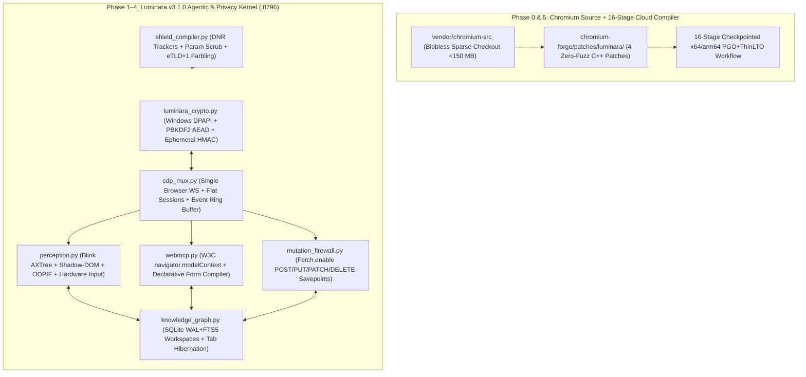

# Luminara Browser v3.1.0 — 100x Engine & Perplexity REA Suite Architecture (`docs/architecture-100x.md`)

Luminara Browser v3.1.0 closes every security, latency, perception, evaluation, and build gap vs. upstream `chromium/chromium` while introducing clean-room agentic security, VRT, monitor, and evaluation primitives Google Chrome cannot ship due to ad/telemetry conflicts.

## Module Map (All Files `< 1,000` Lines, Zero Third-Party Python Dependencies)

| Module | Responsibility |
| :--- | :--- |
| `chromium-forge/forge/chromium_src.py` | Blobless sparse checkout (`<150 MB`), upstream patch dry-run & version provenance audit |
| `chromium-forge/forge/luminara_crypto.py` | Windows DPAPI (`CryptProtectData`), pure-stdlib HKDF+CTR+HMAC AEAD, ephemeral session tokens, ledger signatures |
| `chromium-forge/forge/luminara_security.py` | AEAD-encrypted origin-pinned `LuminaraVault` (auto-migrates legacy plaintext) & binary-safe `LuminaraRedactor` |
| `chromium-forge/forge/cdp_mux.py` | Persistent browser-level multiplexed CDP WebSocket (`<1.5ms` RTT, zero `F12` lockouts, OOPIF flat sessions, event bus) |
| `chromium-forge/forge/perception.py` | Native Blink `AXTree` + open Shadow-DOM piercing + OOPIF indexing + compositor hardware mouse/keyboard input |
| `chromium-forge/forge/webmcp.py` | W3C WebMCP (`navigator.modelContext`) bootstrap + declarative `<form toolname>` / semantic form compiler |
| `chromium-forge/forge/mutation_firewall.py` | `Fetch.enable` savepoint interceptor pausing `POST`/`PUT`/`PATCH`/`DELETE` with secret-scrubbed diff preview |
| `chromium-forge/forge/knowledge_graph.py` | SQLite WAL + FTS5 cross-tab knowledge graph, named Workspaces, and `Page.setWebLifecycleState('frozen')` tab hibernation |
| `chromium-forge/forge/shield_compiler.py` | Privacy Shield v3 (DNR tracker + query-param strip compiler up to 30k rules + eTLD+1 deterministic farbling) |
| `chromium-forge/forge/updater.py` | Zero-telemetry opt-in cryptographic release manifest & SHA-256 artifact verifier |
| `chromium-forge/forge/benchmark_100x.py` | Automated `BM-01`..`BM-06` 100x engine benchmark suite |
| `chromium-forge/forge/rea_harvester.py` | REA v6.5.0 Perplexity suite evidence harvester (`rea_perplexity_evidence.json` + typed `ResidualUnknown` ledger) |
| `chromium-forge/forge/arch_ratchet.py` | `SPACE` + `codescythe` pattern ratchet (`<1,000`L ceiling, `dependencies=[]`, layer guard, dead-file/export reachability) |
| `chromium-forge/forge/sequence_guard.py` | `numbat` partitioned behavioral sequence correlator, `PAUSED_SEQUENCE_BLOCK` guard & signed `CASE-*.zip` forensic bundles |
| `chromium-forge/forge/vrt_isolation.py` | `rules_web_e2e` hermetic `Fetch.enable` declared-origin allowlist & pure-stdlib RFC 2083 PNG pixel-diff VRT |
| `chromium-forge/forge/monitors_eval.py` | `perplexity-py` + `SPACE` fenced SQLite WAL Web Monitors, SSRF-pinned webhooks & CAS `expected_revision` Playbook Revisions |
| `chromium-forge/forge/search_eval_runner.py` | `search_evals` exact `Decimal` `CostLedger`, 14-endpoint wire contract validator & multi-provider F1 grader |
| `chromium-forge/forge/kernel_spec_audit.py` | `pplx-kernels` MoE All-to-All NVSHMEM symmetric-heap alignment & split-phase barrier state-machine auditor |
| `chromium-forge/forge/agent_tools_v31.py` | `v3.1.0` MCP v2 tool schemas (`28` tools, `9` resources) & human UI-key guarded dispatchers |
| `chromium-forge/forge/luminara_telemetry_ui.py` | Zero-XSS `/workspace` Telemetry Cockpit (`7+5` Bento grid, `oklch()` tokens, `STOP ■` `AbortController`, `320px` reflow) |
| `chromium-forge/forge/verifier_perplexity.py` | Fail-closed REA Stage 7 verification (`OBL-15`..`OBL-21`, extending total REA suite to `21/21`) |
| `chromium-forge/patches/luminara/*.patch` | 4 zero-fuzz native C++ Chromium patches (`luminara://` WebUI, `URLLoaderThrottle` hooks, `SidePanelCoordinator`, farbling switches) |
